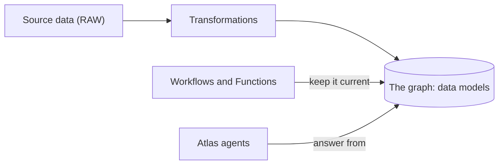

# Integrated Supply Chain documentation

Integrated Supply Chain (ISC) puts a manufacturer's supply chain into one connected graph in Cognite Data Fusion, with Atlas agents that answer questions across it.

> [!NOTE]
> This is the documentation for the ISC offering. Find your reader below, and follow that folder's pages in order.

## Who this is for

| Reader | You are… | You want to… | Go to |
|---|---|---|---|
| **Implementer** | A data engineer or solution architect who is deploying ISC into a customer's CDF project | Deploy it, configure it for the tenant, connect it to the customer's systems and keep it upgraded | [`isc-deployment-and-customization/`](./isc-deployment-and-customization/) |
| **Technical reader** | New to ISC and technical: a solution architect evaluating it, a platform engineer, a data modeler, an Atlas administrator | Understand what is deployed and how it fits together: agents, Functions, workflows, data models, archive and data quality | [`isc-architecture/`](./isc-architecture/) |
| **Business reader** | Someone with no technical background who wants to understand the supply chain side | Learn what ISC covers and how its domains connect, in plain language | [`isc-functional-overview/`](./isc-functional-overview/) |

## Pages, in reading order

**Implementation**
1. [Overview and prerequisites](./isc-deployment-and-customization/1-overview-and-prerequisites.md)
2. [Bring ISC into the customer repo](./isc-deployment-and-customization/2-customer-repo.md)
3. [Configure the tenant](./isc-deployment-and-customization/3-configure.md)
4. [Build, deploy and verify](./isc-deployment-and-customization/4-deploy-and-verify.md)
5. [Load the seed data](./isc-deployment-and-customization/5-load-seed-data.md)
6. [Connect to existing maintenance and manufacturing](./isc-deployment-and-customization/6-customize.md)
7. [Upgrade](./isc-deployment-and-customization/7-upgrade.md)
8. [Custom hierarchies](./isc-deployment-and-customization/advanced/custom-hierarchies.md) (advanced)

**Architecture**
1. [Atlas agents and skills](./isc-architecture/atlas-agents-and-skills.md)
2. [Functions and workflows](./isc-architecture/functions-and-workflows.md)
3. [Data models](./isc-architecture/data-models.md)
4. [Records archive](./isc-architecture/records-archive.md)
5. [Data quality](./isc-architecture/data-quality.md)

**Supply chain**
1. [Overview](./isc-functional-overview/overview.md)
2. The nine domains: [Organizational Foundation](./isc-functional-overview/domains/organizational-foundation.md), [Material Management](./isc-functional-overview/domains/material-management.md), [Technical Structure](./isc-functional-overview/domains/technical-structure.md), Asset Maintenance (no page — covered by the connect module), [Customer Demand Fulfilment](./isc-functional-overview/domains/customer-demand-fulfilment.md), Manufacturing (no page — covered by the connect module), [Shipment & Delivery](./isc-functional-overview/domains/shipment-and-delivery.md), [Sourcing & Procurement](./isc-functional-overview/domains/sourcing-and-procurement.md), [Planning & Forecasting](./isc-functional-overview/domains/planning-and-forecasting.md)

## ISC at a glance

ISC ships as Cognite Toolkit modules and deploys with `cdf deploy`. There is no separate installer. It contains:

- **The modules** to copy into the customer's Toolkit repo ([implementation](./isc-deployment-and-customization/2-customer-repo.md)): `isc_core` and its edges, the connect reference modules, `isc_atlas_agents`, `isc_archival_records`, plus optional `isc_data_mesh` and demo-only `isc_seed_data_ingestion` ([what each one owns](./isc-deployment-and-customization/1-overview-and-prerequisites.md#the-rule-that-decides-where-changes-go)).
- **The data models** that hold the graph ([data models](./isc-architecture/data-models.md)).
- **The Atlas agents and skills** that answer questions, in `isc_atlas_agents` ([agents and skills](./isc-architecture/atlas-agents-and-skills.md)).
- **The Functions and workflows** that load and maintain the data ([functions and workflows](./isc-architecture/functions-and-workflows.md)).
- **The records archive**, where finished items go, in `isc_archival_records` ([records archive](./isc-architecture/records-archive.md)).
- **The data quality rules** that keep the graph reliable ([data quality](./isc-architecture/data-quality.md)).

Resource counts for a healthy deployment are on [the deploy and verify page](./isc-deployment-and-customization/4-deploy-and-verify.md#4-check-fusion).

## Terms

- **Atlas**: Cognite's chat and agent environment in Fusion.
- **Toolkit**: the Cognite Toolkit command line (`cdf`), which deploys configuration kept as files.
- **DMS**: data modeling, where the live graph is stored.
- **Records**: the append-only tier where archived items go.
- **Instance space** and **schema space**: where the data lives, and where the models live.
- **Seed workflow**: the workflow, started by hand, that loads the demo graph.
- **ISA-95 and ISA-88**: the manufacturing standards the manufacturing model follows.
- **`btp_` prefix**: a prefix on ISC's Functions, workflows and transformations. It carries no meaning for users.

Supply-chain terms such as lot, reservation and pegging are defined in the [supply chain overview](./isc-functional-overview/overview.md#terms-youll-see).

## Release

See [RELEASE.md](../RELEASE.md) for what is in this version. This repository is a published copy, so changes made here are overwritten at the next release. See [CONTRIBUTING.md](../CONTRIBUTING.md).
