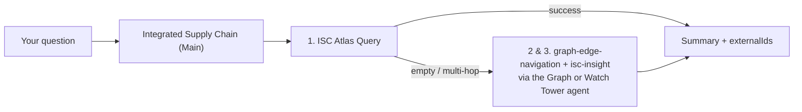

# Atlas agents and skills

*The Atlas agents and skills ISC ships, how they're scoped, how a question gets answered, and how to use them in Atlas chat.*

**Who this is for:** solution architects configuring Atlas, and anyone answering supply-chain questions through it.

## The agents

ISC ships 3 Atlas agents, all under `isc_atlas_agents/agents/`. The `isc_atlas_agents` module is part of the ISC solution and also ships the two Functions the agents call, `fn_btp_graph` and `fn_btp_insight`:

| externalId | Name | Label | Skills attached |
|---|---|---|---|
| `integrated-supply-chain-main-agent` | Integrated Supply Chain (Main) | published | `isc-model-bootstrap`, `isc-atlas-query-tool` |
| `integrated-supply-chain-graph-query-agent` | Graph Traversal (Query) | published | `isc-model-bootstrap`, `isc-atlas-query-tool`, `graph-edge-navigation`, `isc-insight` |
| `integrated-supply-chain-watch-tower-query-agent` | Watch Tower (Query) | published | `isc-model-bootstrap`, `isc-atlas-query-tool`, `graph-edge-navigation`, `isc-insight` |

**Main** is the Fusion entry point — it runs its direct-query skill first and only delegates to the two specialist agents when that comes back empty. All 3 agents are **published**.

## The skills

| Skill | Wraps | Used by | When it's used |
|---|---|---|---|
| `isc-model-bootstrap` | No Function — a shared mental model (view spaces, domain DMs, demo anchors) | All 3 agents | Loaded first, before any query |
| `isc-atlas-query-tool` | Direct DMS query (`list`/`search`/`filter`/`aggregate`) | All 3 agents | Step 1 — tried before graph or insight |
| `graph-edge-navigation` | `fn_btp_graph` | Graph, Watch Tower | Step 2 — hierarchy subtrees, edge hops, multi-hop traversal |
| `isc-insight` | `fn_btp_insight` | Graph, Watch Tower | Step 3 — last resort, denormalized multi-hop tables |

## Scope

`isc-atlas-query-supply-chain-scope.yaml` is a reference copy, not a shared source every agent reads from. It lists the 10 domain models plus `isc_typed_model` and the tenant's instance space, and is kept in line with `isc_core/locations/supply_chain.LocationFilter.yaml`. Each of the 3 agents also carries its own inline copy of that same model list, under its Query tool's `configuration.dataModels`. That's **four copies** in total — the reference file plus one in each agent. Edit one, edit all four, or they drift out of sync.

## How a question gets answered

Main uses a fixed cascade — fastest, most precise read first, specialists only as fallback. ~90%+ of questions answer at step 1, on Main, without delegation.



| Step | Runs in | Skill | What it does | Typical latency |
|---|---|---|---|---|
| 1 | Main | `isc-atlas-query-tool` | Direct read — pegging, inventory retrieve, countries, PO lines | Low |
| 2 | Graph or Watch Tower agent | `graph-edge-navigation` | `fn_btp_graph` — hierarchy subtree, edge lists, hops (7 traversal modes) | Low–medium |
| 3 | Graph or Watch Tower agent | `isc-insight` | `fn_btp_insight` — denormalized multi-hop tables, disruption, war room (13 insight_type modes) | Higher |

When Main delegates, it waits for the subagent's answer and repeats its cited facts verbatim in its own Summary — findings are echoed back, not paraphrased.

## Deployed as part of `isc_atlas_agents`

Agents and Skills ship as YAML under `isc_atlas_agents/agents/`, next to the `fn_btp_graph` and `fn_btp_insight` Functions in `isc_atlas_agents/functions/`. The module depends on `isc_core`, whose data models, instance space and location filter the agents query, so deploy them together. Toolkit only recognizes the Agent and Skill resource kinds with `[alpha_flags]` set — see [page 2](../isc-deployment-and-customization/2-customer-repo.md).

## Quick start

1. Open **Atlas** → **Agent library**.
2. Start with **Integrated Supply Chain (Main)** — the entry agent.
3. Ask in natural language; include `externalId`s when you know them (`shp-df-0003`, `sr-nord-001`, `wo-mr-edge-0001`). These resolve only if the [seed workflow](../isc-deployment-and-customization/5-load-seed-data.md) has loaded the demo graph.
4. Expect a **Summary** plus bullets or a table with cited IDs — not vague paraphrases.

## Which path answers what?

Always start with **Integrated Supply Chain (Main)** — it runs the query step directly; delegate to a specialist only if that comes back empty.

| Question | Step 1 (Query, on Main) | Fallback |
|---|---|---|
| Pegging, status, on-hand inventory | Answers directly | — |
| PO line pegged to a scheduled receipt | `retrieve_instances` on the receipt | Graph edge list |
| Shipment → scheduled receipts | Query execution edges | Graph hop |
| Work order → notifications | Query notification links | Graph edge list |
| Material reservation for a work order component | Query `MaterialReservation` edges | Graph list |
| Cost centers under a business unit (e.g. `bu_emea`) | Query `CostCenter` filtered on `parent` | Graph subtree |
| Hierarchy subtree or edge hops, in general | Query first | Graph, if empty |
| Supplier failure → customer risk | Query supplier edges first | Insight exposure table, via Graph |
| War room tables, supplier exposure | Query first | Insight, via Graph, if needed |
| Delays or exceptions on shipments | Query lane edges first | Watch Tower, if empty |

## What a good answer looks like

```markdown
## Summary
Direct answer in one or two sentences.

## Findings
- Bullet or table with **externalIds** (shp-df-0003, poi-nord-001-10, …)
- Status, quantities, dates when relevant
```

**Do expect:** `externalId`s copied from data, not paraphrased ("`sr-nord-001`," not "the Nordics receipt"); tables when listing several entities; empty sections omitted.

**Do not expect:** write-back to source ERP systems (create PO, reschedule production); answers without IDs when the graph returned them; guaranteed exhaustive lists on paginated reads.

## Sample prompts (demo data)

These use the demo data loaded by the [seed workflow](../isc-deployment-and-customization/5-load-seed-data.md). Use with **Integrated Supply Chain (Main)**:

- *Which PO line is pegged to scheduled receipt sr-nord-001?*
- *List all cost centers under business unit bu_emea*
- *What on-hand inventory exists for material mat-ss-409A? Include warehouse and quantity.*
- *Show me scheduled receipts linked to inbound shipment shp-df-0003*
- *If supplier sup-df-nordic-pulp fails, which shipments are exposed?*
- *Are there any delayed shipments right now?*
- *War room on schedule ps-skg-fc-001 — equipment, personnel, pegged customer orders*

## Troubleshooting

| Symptom | Likely cause | What to do |
|---|---|---|
| Agent not in library | Agents not deployed, or the deploy identity lacks `agentsAcl` ([page 1](../isc-deployment-and-customization/1-overview-and-prerequisites.md#before-you-start)) | `cdf deploy` the `isc_atlas_agents` module (it must be in `selected`); check the service principal's ACLs |
| Query failed / REST 400 | Bad filter or wrong view space | Rephrase with explicit `externalId`; redeploy skills |
| Insight table for simple pegging | Wrong path taken | Redeploy Main; it should query first |
| Vague IDs ("the shipment") | Model or skill drift | Use `externalId`; check agent version |
| "No data" for a known seed anchor | Ingest or quality issue | See [data quality](./data-quality.md) |
| Slow Insight answers | `fn_btp_insight` cold start | Normal for war-room tables; use Query for simple reads |
