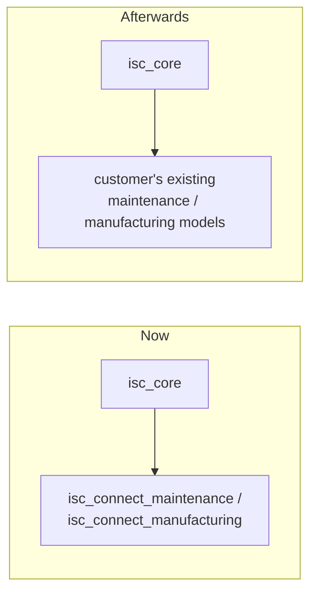

# Connect ISC to existing maintenance and manufacturing

*ISC ships reference maintenance and manufacturing modules. If the customer already has its own, replace them and rewire `isc_core` to point at the customer's models.*

**Before you start:** ISC is deployed ([page 4](./4-deploy-and-verify.md)), and you know which of the customer's existing models cover maintenance and manufacturing.

## The idea

`isc_connect_maintenance` and `isc_connect_manufacturing` are reference implementations, not fixed schema — they exist so ISC has something to resolve to out of the box. If the customer already runs their own maintenance or manufacturing models, drop the reference module and repoint the handful of relations in `isc_core` that currently resolve to it. Everything downstream — Functions, workflows, Atlas agents — keeps working as long as the view it looks up still exists somewhere.



## Rewiring points

Every row is a relation or edge inside `isc_core` whose `source` currently resolves to a view shipped in one of the reference modules. Regenerate this table from the module tree before relying on it for a release you haven't checked — it is long, and it goes stale.

**Asset Maintenance** — `isc_AssetMaintenanceSchemaSpace`, shipped by `isc_connect_maintenance`

| Core view . property | Points at today | Repoint to |
|---|---|---|
| `Warehouse.suppliesToSite` | `FunctionalAsset` | Customer's site/plant view |
| `CostCenter.functionalAssets` | `FunctionalAsset` | Customer's site/plant view |
| `BillOfMaterialsHeader.bomAsset`, `.bomFunctionalLocation`, `.bomPlant` | `FunctionalAsset` | Customer's asset/location view |
| `BillOfMaterialsItem.storageLocation` | `FunctionalAsset` | Customer's location view |
| `SupplierItemRecord.siteId` | `FunctionalAsset` | Customer's site view |
| `PurchaseRequisition.destinationLocationId`, `.sourcePlantId` | `FunctionalAsset` | Customer's site/location view |
| `PurchaseRequisition.workOrderId` | `WorkOrder` | Customer's work order view |
| `PurchaseOrderLineItem.shipTo` (header and item level) | `FunctionalAsset` | Customer's location view |
| `ProductAllocation.allocationPlant` | `FunctionalAsset` | Customer's plant view |
| `Plan.plant` | `FunctionalAsset` | Customer's plant view |
| `Plan.maintenanceOrder` | `WorkOrder` | Customer's work order view |
| `Forecast.plant`, `.storageLocation` | `FunctionalAsset` | Customer's plant/location view |
| `Forecast.workOrder` | `WorkOrder` | Customer's work order view |
| `MasterNotification.linksEntity` | `WorkOrder` | Customer's work order view |
| `tr_btp_mr_edge_functional_assets*` transformations; `supply_chain.LocationFilter` entry | `FunctionalAsset` ingest/scope | Customer's asset source and scope |

**Manufacturing** — `isc_IsaSchemaSpace`, shipped by `isc_connect_manufacturing`

| Core view . property | Points at today | Repoint to |
|---|---|---|
| `MaterialMaster.batch` | `Batch` | Customer's batch view |
| `MaterialMaster.recipe` | `Recipe` | Customer's recipe view |
| `BillOfMaterialsHeader.productDefinitions` | `ProductDefinition` | Customer's product definition view |
| `Plan.productionRequestRef` | `ProductionRequest` | Customer's production request view |
| `Forecast.productionRequest`, `.peggedProductionRequest` | `ProductionRequest` | Customer's production request view |
| `MasterNotification.linkedFromProductionSchedules` | `ProductionSchedule` | Customer's production schedule view |
| `supply_chain.LocationFilter` (`Manufacturing` entry) | `ProductionSchedule` scope | Customer's manufacturing scope |

## Steps

1. List the rewiring points that apply — not every tenant replaces both modules.
2. In `selected`, swap the `isc_connect_*` module being replaced for the customer's own module(s).
3. Repoint the references in `isc_core`: relation `source`, the transformations that populate them, and any edge `source`/`type`.
4. Update the Functions and Atlas agents that name the replaced views — see [architecture/atlas-agents-and-skills.md](../isc-architecture/atlas-agents-and-skills.md) and [architecture/functions-and-workflows.md](../isc-architecture/functions-and-workflows.md) for where those names live.
5. `cdf deploy --dry-run`, then deploy and verify — same checks as [page 4](./4-deploy-and-verify.md).

## Worked example

`MaterialMaster.batch` currently points at the shipped `Batch` view:

```yaml
batch:
  source:
    space: {{ isc_IsaSchemaSpace }}
    externalId: Batch
    version: {{ isc_viewVersion }}
    type: view
```

To point it at the customer's own batch view, change `space` — and `externalId`, if the customer's view is named differently — to the customer's model. The `source:` block is the only thing that changes; the property name (`batch`) and its container stay as they are.

## Keep consistent

Agents and Functions look up ISC views by their identifiers, so when you repoint one, change **every** place that names it — not just the relation in `isc_core`. Use the rewiring table above as the checklist, not a one-off fix in the view you happened to be looking at.

The same applies if you replace `isc_edges/isc_connect_edges` instead of (or alongside) the maintenance/manufacturing modules: `fn_btp_edge` defaults to validating the `MaterialReservation` edge view, and the Atlas agents' scope and skills name `MaterialReservation` and the other `isc_connect_edges` views directly. Keep those names if you keep the shipped edge views, or repoint every reference to them — in `fn_btp_edge`'s config and in the agents/skills — if you replace the module.

## Other changes

| You want to | Do this |
|---|---|
| Add a capability the customer doesn't have yet | A new module in the customer repo — don't extend `isc_connect_*`. |
| Add a new relationship between two fixed `isc_core` types | Usually `isc_edges/isc_connect_edges`, with a new external ID — edges are relationship glue, not core schema. If you're unsure whether it's tenant-specific, default to putting it there rather than in `isc_edges/isc_core_edges`. |
| Add a new data product or Rule Set | `isc_data_mesh`. |
| Scope ISC to one site only | The customer's own location config, not a module change. |

## Add wiring ISC doesn't have yet

This is different from rewiring above: rewiring repoints an *existing* reference at a different model; this adds a reference ISC doesn't ship at all, for data the tenant has but ISC doesn't model.

**Example:** a tenant's CMMS produces work-request records ISC doesn't ingest today. Add a new view in `isc_connect_maintenance` and link it to the fixed `WorkOrder` view that already ships there.

1. **Land the data.** A new RAW table in the connect module, e.g. `modules/isc/isc_connect_maintenance/raw/acme_work_requests.Table.yaml`, with `dbName: '{{ isc_RawDatabase }}'`.
2. **Add the view.** A new container and view in the connect module, with a **new** external ID — reusing a fixed `isc_core` name collides with the product's own resource of that ID.
3. **Reference the fixed view by ID and version, don't copy it.** Point the new view's relation at the shipped `WorkOrder` view using its external ID and `{{ isc_viewVersion }}`:

   ```yaml
   relatedWorkOrder:
     source:
       space: '{{ isc_AssetMaintenanceSchemaSpace }}'
       externalId: WorkOrder
       version: '{{ isc_viewVersion }}'
       type: view
   ```

   Copying `WorkOrder`'s definition into your module instead creates a second, divergent copy that silently drifts the moment the product ships a schema change to the real one.
4. **Add the transformation** mapping the RAW table into the new view.
5. **New edge type, if needed.** If the relation to `WorkOrder` needs its own properties (not just a direct relation), add an edge type in `isc_edges/isc_connect_edges` instead.
6. **Deploy.** No `config.<env>.yaml` change is needed if the connect module is already in `selected` — [page 4](./4-deploy-and-verify.md).

Record this in `CUSTOMIZATIONS.md` the same as a rewiring change.

## Track your rewiring

Keep a `CUSTOMIZATIONS.md` in the customer repo listing every reference you repointed — core view, property, old target, new target. It becomes essential: it's the checklist you replay after every upgrade, since an upgrade replaces `isc_core` wholesale and would otherwise silently undo the rewiring.

## Check it worked

The new relations resolve in **Data explorer**, and the Atlas agents answer from the customer's models, not the shipped reference data.

## If it fails

| Symptom | Cause | Fix |
|---|---|---|
| A relation shows no target | The repointed `source` doesn't match an existing view | Check the space, externalId, and version against the customer's model. |
| An agent or Function still returns reference-module data | It still names the old view | Find every reference to it in the rewiring table and update it. |

## What's next

- Upgrading after this? Reapply the rewiring using your `CUSTOMIZATIONS.md` — see [upgrade](./7-upgrade.md).
